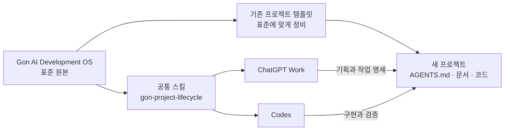
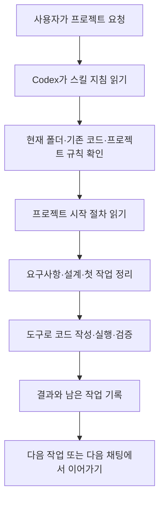

# 3.Gon AI Development OS 표준 확인 경로 찾기

2026-10-31 조회 보관본. 과거 제안·경로·지원 정보는 당시 기록이며 현재 실행 지침이 아닙니다. 긴 응답의 생략은 표시합니다. 도구 출력·인증 정보는 포함하지 않습니다.

## 사용자 요청

개발 워크플로우 정리
에서 보면 "새 프로젝트를 시작하자. 학생 시험지를 촬영하여 OCR로 변환하고, 문제 해설을 생성하는 웹서비스를 만들고 싶어. Gon AI Development OS 표준에 따라 기획부터 개발, 테스트, 배포 준비까지 진행해줘." 라고 요청하라 했는데 Gon AI Development OS 표준 은 스킬로 만들어진것이 아닌데 어떻게 새 프로젝트 진행에서 이 표준을 확인하게 되지 


## 작성된 답변

**그 문장만으로는 표준을 정확히 확인하도록 보장할 수 없습니다.** “Gon AI Development OS”라는 이름만 쓰고, 실제 문서의 위치나 읽는 절차를 빠뜨린 안내입니다.

스킬로 만들어야만 적용할 수 있는 것은 아닙니다. 다음 중 하나로 **표준 원문과 새 프로젝트를 연결**해야 합니다.

| 방식 | 표준을 확인하는 경로 |
|---|---|
| 문서 직접 지정 | 시작 요청에 표준 문서의 경로·링크를 넣고 먼저 읽도록 지시 |
| 프로젝트 템플릿 | 표준 문서가 들어 있는 템플릿으로 프로젝트를 만들고 `AGENTS.md`에서 참조 |
| 스킬 | 표준을 읽고 프로젝트를 구성하는 반복 절차를 스킬로 등록·호출 |

Codex에서는 프로젝트의 `AGENTS.md`에 기본 지침을 넣을 수 있습니다. 여기에 “작업 전에 이 표준 문서를 읽는다”는 연결을 두면 됩니다. [공식 지침](https://learn.chatgpt.com/docs/agent-configuration/agents-md#layer-project-instructions)

따라서 기존 안내에는 적어도 **“먼저 지정한 표준 문서를 읽고, 확인한 문서와 적용할 규칙을 밝힌 뒤 진행해줘. 문서에 접근하지 못하면 표준 내용을 추측하지 말고 알려줘”**라는 조건과 실제 경로가 필요합니다.

이전 작업 기록에는 관련 자료가 `krdn/ai-engineering-os` 보일러플레이트로 남아 있습니다. 다만 **그 자료가 지금 말씀하신 ‘Gon AI Development OS’의 정확한 원본인지는 이번에 확인하지 못했고**, ‘개발 워크플로우 정리’ 원문도 찾지 못했습니다.

즉, 지적하신 빈틈이 맞습니다. **표준 이름만으로 실행을 요청하게 한 안내는 불완전하며, 원본 위치와 로딩 절차를 함께 적어야 합니다.**


## 사용자 요청

그럼 완벽하게 너가 한번 구성 방법을 제안해 줘.


## 작성된 답변

제가 추천하는 구성은 **표준 원본 하나를 만들고, 공통 스킬로 Work와 Codex에 전달하며, 각 프로젝트에는 적용한 표준의 사본과 프로젝트별 결정을 남기는 방식**입니다.

먼저 이전 답변을 정정하겠습니다. 원래의 **「2.개발 워크플로우 정리」 대화**를 확인해 보니, 여기서 말한 *Gon AI Development OS*는 최근 제안된 통합 워크플로우입니다. 제가 언급한 [ai-engineering-os](https://github.com/krdn/ai-engineering-os)는 이전에 만들어진 별도의 보일러플레이트입니다. 재사용할 수 있지만 두 가지를 같은 표준으로 단정할 수는 없습니다.

현재 확인된 상태는 다음과 같습니다.

- `gon-project-lifecycle` 스킬은 현재 세션과 개인 스킬 경로에서 확인되지 않았습니다.
- `gon-web-engineering`은 이미 설치되어 있습니다.
- `ai-engineering-os`는 실제 GitHub 템플릿이지만, 새로운 통합 표준에 맞게 정리된 상태인지는 추가 작업이 필요합니다.



위 그림은 **제안하는 구성**입니다. 화살표가 환경 간 자동 전달을 의미하지는 않습니다.

1. **표준 원본을 한 곳에 둡니다.** 기존 템플릿과 구분되는 비공개 저장소를 하나 두고, 그 안에서 표준 문서와 스킬을 함께 관리하는 것을 권장합니다.

   ```text
   gon-development-os/                 # 새로 만들 것을 제안
   ├── plugin.json
   └── skills/
       └── gon-project-lifecycle/
           ├── SKILL.md
           └── references/
               └── standard.md          # 표준 원본
   ```

   `standard.md`에는 프로젝트 시작, 작업 크기에 따른 절차, 결과 검증, 리뷰, 인계 원칙을 적습니다. `SKILL.md`에는 **언제 표준을 읽고 어떻게 적용할지**만 간결하게 둡니다. 표준 변경은 Git에서 버전과 이력을 남깁니다.

2. **공통 스킬을 Work와 Codex에서 사용할 수 있게 배포합니다.** `gon-project-lifecycle`을 한 번 작성하고, 개인용 플러그인으로 패키징해 지원되는 환경에 설치하는 방식을 추천합니다. OpenAI 문서도 재사용 절차에는 스킬을, 설치·공유할 묶음에는 플러그인을 사용하도록 안내합니다. [스킬과 플러그인](https://learn.chatgpt.com/docs/skills-and-plugins), [플러그인 구성](https://developers.openai.com/plugins/build/plugins)

   스킬의 적용 조건은 다음처럼 잡습니다.

   - 새 프로젝트를 시작하거나 Gon AI Development OS 적용을 요청한 경우 사용합니다.
   - 기존 프로젝트는 현재 지침과 미커밋 변경을 먼저 확인하고 보존합니다.
   - 웹 프로젝트라면 해당 실행 환경에서 기존 `gon-web-engineering`을 사용할 수 있는지 확인하고 연결합니다.
   - 표준 문서나 필요한 스킬을 읽지 못하면 적용했다고 주장하지 않습니다.

   플러그인을 한 환경에 설치했다고 모든 환경에서 자동으로 사용할 수 있다고 가정하지 않고, **Work와 Codex에서 각각 활성화와 실제 호출을 확인**해야 합니다. 자연어 요청에 따라 스킬이 선택될 수 있지만 항상 보장되지는 않으므로, 확실하게 호출하려면 설치 후 표시되는 스킬을 Work에서는 `@`, Codex에서는 `$`로 명시합니다.

3. **기존 템플릿을 새 표준과 연결합니다.** [ai-engineering-os의 시작 안내](</home/gon/Documents/Codex/2026-09-12/referenced-chatgpt-conversation-this-is-an/outputs/ai-engineering-os/docs/01-getting-started.md>)와 기존 `.ai` 계약은 활용하되, 현재 내용을 그대로 모든 프로젝트에 복사하기 전에 충돌을 정리해야 합니다.

   특히 기존 템플릿의 모델 registry와 리뷰 규칙은 최근 대화의 모델 배치 및 현재 사용자의 설정과 차이가 있습니다. 예를 들어 설치된 `model-router`는 **명시적으로 호출했을 때만** 적용되는 별도 정책입니다. 따라서 스킬 설치가 현재 대화의 모델을 바꾸거나, 템플릿의 후보 모델이 실제 검증된 것처럼 취급하지 않도록 정리해야 합니다.

   새 프로젝트에는 필요한 것만 남깁니다.

   ```text
   새 프로젝트/
   ├── AGENTS.md
   ├── PROJECT.md
   ├── ARCHITECT.md
   ├── docs/ai/standard.md     # 적용한 표준의 버전이 기록된 사본
   └── .ai/tasks/              # 필요한 규모의 작업에 사용
   ```

   기존 템플릿의 파일과 예제는 무조건 삭제하거나 복제하지 않고, 실제 프로젝트에 필요한 범위를 선택합니다. `AGENTS.md`에는 프로젝트 문서와 표준 사본을 읽도록 짧게 연결합니다. 표준이 나중에 바뀌어도 기존 프로젝트가 조용히 바뀌지 않도록, **적용한 표준 버전과 기준 커밋을 기록하고 변경 시 검토**합니다.

4. **Work와 Codex의 인계를 명시합니다.** Work는 요구사항과 작업 명세를 준비하고, Codex는 프로젝트 파일을 읽어 구현·검증합니다. 결과는 프로젝트 문서, 커밋, PR 등 실제 접근 가능한 곳에서 주고받습니다. 연결된 도구나 권한이 없다면 인계 자료를 만들고 그 상태를 알려야 합니다.

   작업 규모도 구분합니다. 오탈자나 단순 편집에는 전체 계획과 별도 리뷰를 붙이지 않고, 다중 파일 기능이나 재현 가능한 버그에는 필요한 계획·테스트·완료 경계 리뷰를 적용합니다. 실제 배포는 **배포 준비**와 구분해 사용자가 허용한 범위에서 진행합니다.

구성을 마친 뒤에는 깨끗한 새 채팅에서 다음을 확인해야 합니다.

- Work와 Codex가 각각 스킬과 표준 본문을 실제로 읽는지
- 새 프로젝트에 올바른 지침과 표준 버전이 남는지
- 웹이 아닌 프로젝트에 웹 기술을 강제하지 않는지
- 기존 프로젝트의 지침과 변경 사항을 보존하는지
- 표준이나 GitHub에 접근하지 못했을 때 성공으로 보고하지 않는지
- 실제 제품 테스트와 CI 결과를 템플릿 검사 결과와 구분하는지

이 구성이 검증되면 말씀하신 한 문장으로 시작하는 경험에 가까워집니다. 다만 자연어만으로 스킬이 선택되는지는 실제 환경에서 확인해야 하므로, **처음에는 명시 호출로 검증하고 이후 자동 선택의 신뢰도를 확인**하는 것이 좋겠습니다.

아직 스킬 설치나 저장소 변경은 하지 않았습니다. 위 내용은 현재 상태를 확인한 뒤 제안하는 구성안입니다.


## 사용자 요청

너가 제안한 내용이 이해가 잘 안되 정확하게 구체적으로 이해하기 쉽게 다시 설명해줘, 그리고 gon-project-lifecycle 스킬 새로 추가 했어.  


## 작성된 답변

**이제 `gon-project-lifecycle` 스킬이 있으므로, 현재 Codex에서는 이 스킬을 호출해 프로젝트를 시작하면 됩니다.** 실제 파일을 읽어 보니 프로젝트 시작, 개발, 검증, 중단 후 재개 절차가 들어 있습니다.

앞선 설명은 여러 환경에 배포하는 방법까지 한꺼번에 설명해서 복잡했습니다. 지금은 다음 세 가지로 이해하시면 됩니다.

| 구성 요소 | 쉽게 말하면 | 시험지 OCR 서비스에서 하는 일 |
|---|---|---|
| `gon-project-lifecycle` | **개발 진행 설명서** | 요구사항 정리 → 작업 나누기 → 개발 → 검증 → 결과 기록 |
| `gon-web-engineering` | **웹 개발 설명서** | 화면·서버·DB를 어떻게 구성하고 검사할지 안내 |
| 프로젝트의 문서 | **이번 프로젝트의 기록장** | 만들 기능, 선택한 기술, 완료한 작업과 다음 작업을 보관 |

두 스킬은 여러 프로젝트에서 재사용합니다. 프로젝트 문서는 시험지 OCR 서비스처럼 **각 제품에 맞게 작성**합니다.

**실제로는 이렇게 사용합니다.**

새 프로젝트 폴더를 Codex에서 열고 다음처럼 요청합니다.

:::writing{variant="standard" id="73184"}
$gon-project-lifecycle

학생 시험지를 촬영하여 OCR로 변환하고, 문제 해설을 생성하는 웹서비스를 만들고 싶어.

기획부터 개발, 테스트, 배포 준비까지 진행해줘.
웹 개발에는 gon-web-engineering 스킬도 적용해줘.
:::

그러면 제가 다음 순서로 진행합니다.

1. **무엇을 만들지 구체화합니다.**  
   예를 들어 첫 구현 범위를 “사진 한 장 업로드 → 인식한 글자 확인·수정 → 문제 해설 보기”로 정하고, 무엇을 확인하면 성공인지 적습니다. 중요한 미정 사항은 구분해서 남깁니다.

2. **프로젝트에 필요한 문서를 작성합니다.**  
   새 프로젝트라면 다음과 같은 기록을 만듭니다. 기존 문서가 있으면 그 문서를 이어서 사용합니다.

   | 문서 | 담는 내용 |
   |---|---|
   | `AGENTS.md` | 이 프로젝트에서 AI가 지켜야 할 규칙과 읽을 문서 |
   | `docs/PRODUCT.md` | 누구를 위해 무엇을 만드는지, 기능과 완료 조건 |
   | `docs/ARCHITECTURE.md` | 화면·서버·데이터 구성과 선택 이유 |
   | `docs/PLAN.md` | 구현 순서와 다음 작업 |
   | `docs/STATE.md` | 실제 완료한 것, 검증 결과, 남은 것 |

3. **작은 기능부터 구현하고 실제로 확인합니다.**  
   업로드 기능을 만들면 업로드가 되는지 확인하고, OCR을 연결하면 실제 사진으로 결과를 확인합니다. 문서 작성으로 끝내지 않고 요청한 구현과 검증을 이어갑니다.

4. **다음에 이어갈 수 있도록 기록합니다.**  
   예를 들어 “업로드는 확인 완료, OCR은 연결됐지만 실제 시험지 품질 평가는 남음”처럼 사실대로 남깁니다. 다음 채팅에서는 그 기록과 현재 코드를 확인해 이어갑니다.

**그러면 AI는 표준을 어디에서 확인하느냐?**

이번에 추가한 스킬의 실제 파일에서 확인합니다.

`요청에서 스킬 지정 → SKILL.md 읽기 → 현재 단계에 필요한 참조 문서 읽기 → 프로젝트에 적용`

따라서 이제는 “Gon 표준”이라는 이름의 의미를 추측하는 데 의존하지 않습니다. **실제로 읽을 작업 지침이 생긴 것입니다.** 처음 사용할 때는 위 예시처럼 `$gon-project-lifecycle`을 명시하는 것이 가장 확실합니다.

제가 앞서 제안한 별도 표준 저장소와 플러그인은 **이 스킬을 여러 컴퓨터나 Work에도 배포하고 버전 관리할 때** 필요한 확장 방법입니다. 현재 Codex에서 사용을 시작하기 위해 먼저 모두 구축할 필요는 없습니다. Work에서 사용할 수 있는지는 그 환경에서도 별도로 확인해야 합니다.

현재 확인한 것은 **스킬이 이 세션에 제공되고, 본문과 프로젝트 시작·개발 절차를 읽을 수 있다는 것**입니다. 실제 새 프로젝트에서 처음부터 끝까지 잘 적용되는지는 첫 사용으로 확인하면 됩니다.

## 사용자 요청

gon-development-os 가 뭐야. 작동원리등 구체적인 설명이 필요해. 


## 작성된 답변

**`gon-development-os`는 제가 앞서 제안한 ‘개발 표준과 스킬을 함께 보관·배포할 묶음’의 가칭입니다.** 이 대화에서 제가 만들거나 설치한 것은 아닙니다. 제안한 이름과 실제 설치된 스킬을 섞어 설명해서 혼란을 줬습니다.

여기서 **OS는 프로젝트 개발을 진행하는 공통 체계**라는 뜻입니다. 현재 실제로 사용할 수 있는 것은 새로 추가하신 **`gon-project-lifecycle` 스킬**입니다.

| 이름 | 의미 | 확인된 상태 |
|---|---|---|
| **Gon AI Development OS** | 프로젝트 시작부터 개발·검증·전달까지의 개발 방식 | 대화에서 정리한 표준 |
| **`gon-development-os`** | 그 표준과 스킬을 모아 관리할 저장소·패키지 이름 | 제가 제안한 가칭 |
| **`gon-project-lifecycle`** | 그 개발 절차를 Codex에게 알려주는 작업 지침 | 현재 세션에서 읽기 확인 |
| **`gon-web-engineering`** | 웹 프로젝트의 기술 구성·구현·검증 지침 | 현재 사용 가능한 스킬 |

**실제 작동 주체는 Codex입니다. 스킬은 Codex가 읽고 따르는 설명서입니다.**

예를 들어 다음 요청을 받았다고 하겠습니다.

> `$gon-project-lifecycle` 시험지 사진을 OCR로 변환하고 해설을 제공하는 웹서비스를 만들어줘.

그러면 다음처럼 작동합니다.



구체적으로는 이렇게 연결됩니다.

1. **Codex가 스킬 파일을 읽습니다.**  
   현재 설치된 [SKILL.md](/home/gon/.agents/skills/gon-project-lifecycle/SKILL.md)에 “어떤 상황에서 무엇을 확인하고 어떤 절차를 따를지”가 적혀 있습니다. 프로젝트 시작 요청이므로 그 안에서 연결한 `project-start.md`를 읽습니다.

2. **이번 프로젝트의 사실을 확인합니다.**  
   새 폴더인지, 기존 코드가 있는지, 이미 정한 기술이나 규칙이 있는지 확인합니다. 스킬이 모든 프로젝트에 같은 코드를 넣는 방식은 아닙니다.

3. **이번 제품에 맞는 작업을 정합니다.**  
   시험지 OCR이라면 첫 구현 범위를 “사진 업로드 → 인식 결과 확인 → 해설 표시”처럼 정합니다. 무엇이 구현됐고 무엇을 확인해야 성공인지 프로젝트 문서에 남깁니다.

4. **Codex가 실제 도구를 사용합니다.**  
   파일을 작성하고, 필요한 프로그램을 실행하고, 테스트합니다. 웹 구현이 필요하면 `gon-web-engineering`의 관련 지침도 읽습니다. **스킬 문서를 읽는 것과 프로그램이 실제로 동작하는 것은 별도로 확인합니다.**

5. **결과를 기록합니다.**  
   예를 들어 “업로드 확인 완료, OCR 결과 품질 평가 미실행”처럼 기록합니다. 다음 채팅에서는 그 기록과 현재 코드를 대조해 이어갑니다.

현재 스킬에는 문서 틀을 만드는 보조 스크립트도 있습니다. 다만 스킬 안내에 따르면 이 스크립트의 역할은 **선택한 문서의 틀 생성**입니다. 실제 웹서비스 구현은 Codex가 별도로 수행합니다.

**그렇다면 제가 제안했던 `gon-development-os` 묶음은 어디에 쓰일까요?**

앞으로 이런 파일을 한곳에서 관리하는 용도입니다.

```text
gon-development-os/              ← 제안한 저장소
├── 개발 표준 문서
├── gon-project-lifecycle 스킬
└── 설치·배포에 필요한 파일
```

이렇게 관리하면 표준을 수정한 이력을 남기고, 다른 컴퓨터에도 같은 버전을 설치하기 편해집니다. 플러그인으로 포장하는 것은 이 묶음을 지원되는 Work·Codex 환경에 설치하기 위한 배포 방법입니다.

**지금 Codex에서 프로젝트를 진행하는 데는 별도 `gon-development-os` 묶음이 필요하지 않습니다.** 이미 추가하신 `gon-project-lifecycle`이 필요한 절차를 담고 있습니다. 현재 사용할 구조는 다음과 같습니다.

**사용자 요청 → Codex가 `gon-project-lifecycle` 읽기 → 프로젝트에 맞게 구현·검증 → 프로젝트 문서에 결과 기록**

스킬이 잘 설치돼 있다는 것과 모든 절차가 정확하게 수행된다는 것은 별개이므로, 실제 결과는 코드·실행 화면·테스트 결과로 확인해야 합니다.

